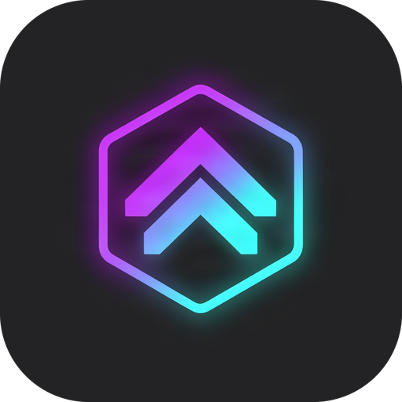
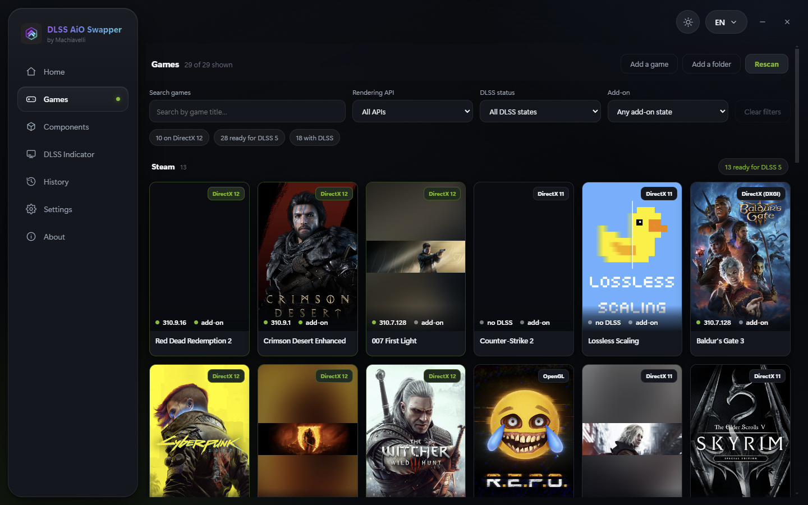
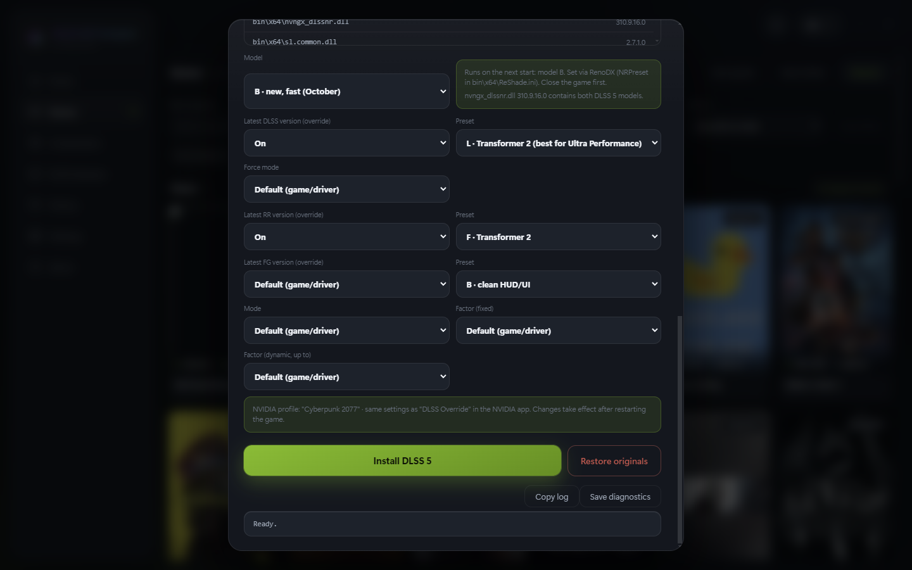
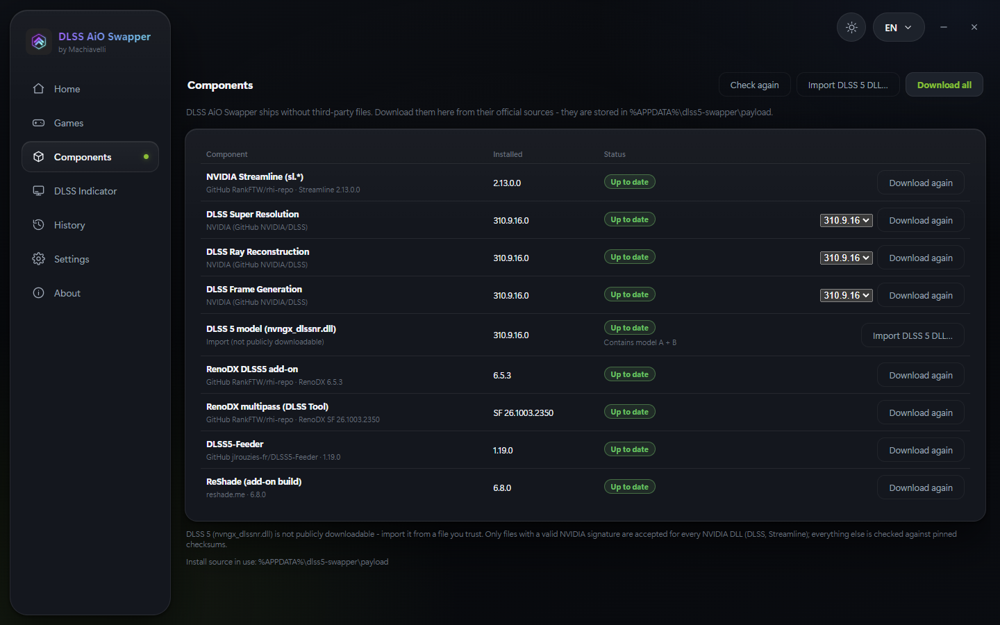
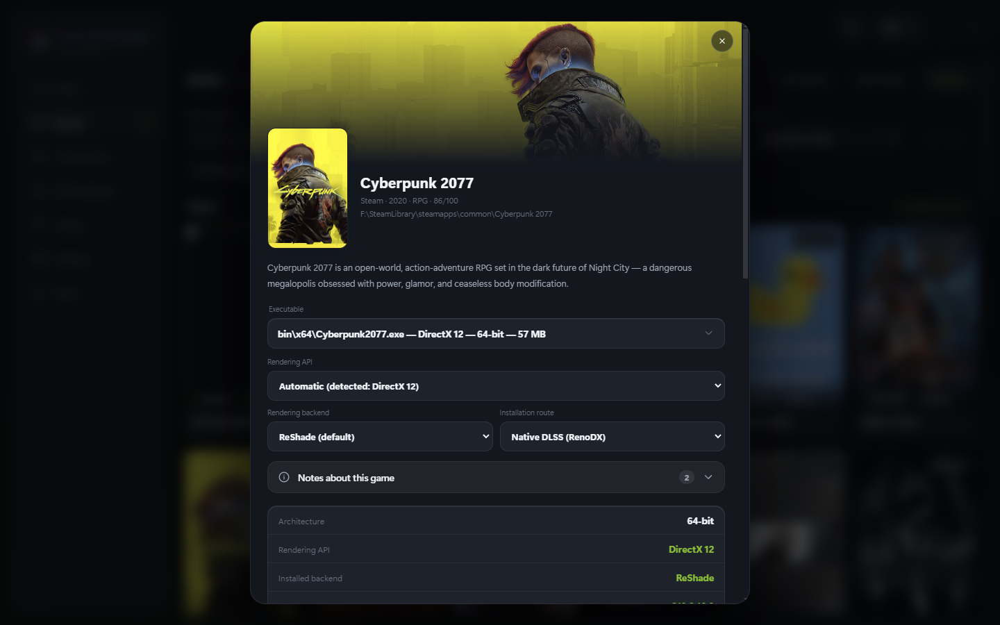
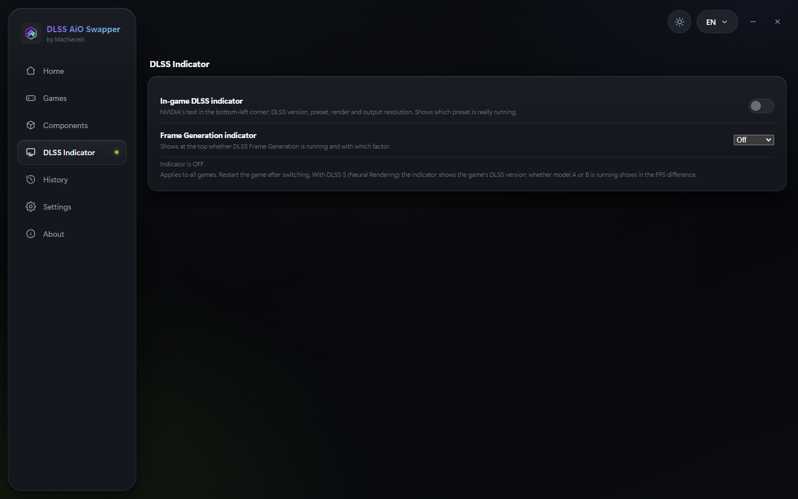

<p align="center">
  
</p>

<h1 align="center">DLSS AiO Swapper by Machiavelli</h1>

<p align="center">
  <b>The all-in-one DLSS swapper.</b> One-click DLSS 5 Neural Rendering, the new Preset B, per-game NVIDIA DLSS presets, the DLSS indicator and DLL management – no Profile Inspector, no copying files around.
</p>

<p align="center">
  <a href="../../releases/latest"></a>
  <a href="../../releases"></a>
  <a href="../../stargazers"></a>
</p>

<p align="center">
  
</p>

---

## What is DLSS AiO Swapper?

**DLSS AiO Swapper** ("All in One") is a DLSS swapper and DLSS 5 installer – a Windows app for PC gamers with an NVIDIA RTX graphics card. It brings everything around NVIDIA DLSS together in one place:

- It **finds your installed games**, shows them as a library with cover art and detects which DLSS files and which graphics API (DirectX 9–12, Vulkan, OpenGL) each game uses.
- It **installs DLSS 5 Neural Rendering** – NVIDIA's AI technique that re-lights the finished frame (materials, skin, lighting) – into your games with one click, even into games that don't officially support DLSS 5.
- It **updates a game's DLSS files** (Super Resolution, Ray Reconstruction, Frame Generation) to newer versions.
- It sets **NVIDIA driver settings per game** (presets, DLAA, multi frame generation) and toggles the **DLSS indicator** on or off.
- It **backs everything up first** and undoes any change with one click.

In short: instead of Profile Inspector, registry tweaks, ReShade setup, add-on folders and copying DLLs by hand – one app, one click.

## Screenshots

| | |
|---|---|
|  |  |
| **Per game:** DLSS 5 model A/B, Super Resolution, Ray Reconstruction and Frame Generation presets – then *Install DLSS 5*. | **Components:** every DLL straight from its official source, NVIDIA signature checked. |
|  |  |
| **Game page:** detected executable, API and the right install route, picked automatically. | **DLSS indicator:** NVIDIA's in-game overlay on or off with one switch. |

## Why this app?

Every swapper and every tool I tried was missing something. One could do DLSS 5 but no presets. Another could do presets but no DLSS 5. The indicator needed a registry tweak, the model needed Profile Inspector…

So I **rebuilt this app from the ground up with Claude Opus 5.5** – with everything I actually need when I play. One click and the game has DLSS 5. Everything else you set right inside the app.

## Features

### Truly one click
Pick a game, press **Install** – the app works out the right route for that game and sets up **everything** it needs, automatically:

| What | What it does |
|---|---|
| **ReShade** (add-on build) | the loader the DLSS 5 add-ons run in – installed and configured for the game's API |
| **RenoDX DLSS5** (+ multipass build) | runs DLSS 5 Neural Rendering in games that already have DLSS |
| **DLSS5-Feeder** | brings DLSS 5 to games **without** DLSS (DirectX 9–12, Vulkan, OpenGL, even 32-bit and emulators) |
| **OptiScaler** (DLSS-NR builds) | alternative route that replaces the game's upscaler and runs DLSS 5 on top – also for FSR/XeSS games |
| **dgVoodoo 2** | wrapper for old DirectX 8/9 games so they can use the modern route |
| **LumeniteFX** | motion-vector / depth shaders the Feeder needs in games without DLSS |
| **NVIDIA DLSS SR / RR / FG + Streamline** | the newest DLSS files, placed next to the game |
| **DLSS 5 model, presets & indicator** | set Preset A/B, SR/RR/FG presets and the DLSS indicator right after installing – on the same page |

No ReShade installer to click through, no add-on folders, no INI editing – and *"Restore originals"* removes all of it again.

### DLSS 5 Neural Rendering
- **One click per game** – installs DLSS 5 into games with DLSS (via RenoDX or OptiScaler) and even into games **without** DLSS (via DLSS5-Feeder, including Vulkan and older DirectX titles).
- **The new Preset B (October 2026)** – NVIDIA's reworked DLSS 5 model (announced the week of October 13, 2026; runtime `nvngx_dlssnr.dll` 310.9.16 since October 16, 2026): about **24 % smaller, ~20 % less VRAM at 4K and up to twice as fast**. In my own tests: **+10–15 % FPS at 1440p**, and considerably more depending on game and resolution.
- **Choose the model per game** – Preset **B** (new, fast) or Preset **A** (the older September model). Verified with NVIDIA's NGX logs, not guessed.
- **Backup & undo** – everything is backed up before a change; *"Restore originals"* puts the game back exactly as it was.

### NVIDIA DLSS per game – right in the app
The same settings as "DLSS Override" in the NVIDIA app, laid out clearly on each game's page:
- **Super Resolution** – force the latest DLSS version, preset **K / L / M / J / F / E / D**, mode **DLAA / Quality / Balanced / Performance / Ultra Performance**
- **Ray Reconstruction** – override and preset **D / E / F**
- **Frame Generation** – override, preset **A / B / C**, **fixed 2x–6x** or **dynamic**
- Anything you already set in the NVIDIA app is detected and shown.

### DLSS indicator
- NVIDIA's in-game overlay (DLSS version, preset, resolution + frame generation info) with a single **on/off** switch – no registry editing.

### Components & DLLs
- Download **DLSS SR / RR / FG** straight from NVIDIA – any published version.
- **Streamline, RenoDX, DLSS5-Feeder, ReShade, OptiScaler, dgVoodoo and LumeniteFX** are fetched automatically from their original sources – only when a game actually needs them.
- **Security:** every NVIDIA file is checked for a valid *NVIDIA Corporation* signature before use, every other download against a pinned SHA-256 hash. Unsigned or modified files are rejected.

### Also
- Finds your games automatically (Steam, Epic, Ubisoft, GOG, custom folders) – with cover art.
- Two designs, light/dark mode, many languages.
- No account, no community servers, no telemetry. The app only connects to the download sources listed below.

## Where do the files come from?

The repository and the installer contain **not a single third-party DLL**. The app downloads everything itself:

| Component | Source | Verification |
|---|---|---|
| DLSS SR / RR / FG (`nvngx_dlss`, `nvngx_dlssd`, `nvngx_dlssg`) | Official from NVIDIA: [NVIDIA/DLSS](https://github.com/NVIDIA/DLSS) (any published version) | NVIDIA signature + version number |
| Streamline 2.13 (`sl.*.dll`) | [RankFTW/rhi-repo](https://github.com/RankFTW/rhi-repo) | SHA-256 + NVIDIA signature |
| RenoDX DLSS5 8.5.0-rc10 (lecram) + multipass (ShortFuse) | [RankFTW/rhi-repo](https://github.com/RankFTW/rhi-repo) | SHA-256 |
| DLSS5-Feeder 1.19.0 | [jlrouzies-fr/DLSS5-Feeder](https://github.com/jlrouzies-fr/DLSS5-Feeder) | SHA-256 |
| ReShade 6.8.0 (add-on build) | [reshade.me](https://reshade.me) | SHA-256 |
| OptiScaler DLSS-NR builds | [Dagherbou/OptiScaler_DLSSNR](https://github.com/Dagherbou/OptiScaler_DLSSNR), [jlrouzies-fr/OptiScaler-DLSSNR-PreSR-Multipass](https://github.com/jlrouzies-fr/OptiScaler-DLSSNR-PreSR-Multipass) | SHA-256 |
| dgVoodoo 2.87.5 | [dege-diosg/dgVoodoo2](https://github.com/dege-diosg/dgVoodoo2) | SHA-256 |
| LumeniteFX shaders | [umar-afzaal/LumeniteFX](https://github.com/umar-afzaal/LumeniteFX) | pinned commit |
| **DLSS 5 runtime `nvngx_dlssnr.dll`** | **not included, no download** – see below | NVIDIA signature |

### What about the DLSS 5 DLL (`nvngx_dlssnr.dll`)?
**The brand-new DLSS 5 DLL (310.9.16 with Preset B) is not included in the app yet.** NVIDIA has not publicly released the DLSS 5 runtime so far – it only ships with games that officially support DLSS 5 (currently NBA 2K27). That's why it is neither hosted nor linked here.

- **As soon as NVIDIA publishes the DLL officially, it will be added to the app via an update** – then it's just one click.
- **Until then:** if you **own NBA 2K27**, you'll find the file in the game folder; with a bit of research you can also find it online. Add it to the app via **Components → Import DLSS 5 DLL** (file or ZIP).
- The app only accepts files with a **valid NVIDIA signature** – tampered or fake DLLs are rejected. It also shows you the version:
  - **310.9.16 or newer** → contains Preset **A and B** (recommended)
  - **310.8.x** → Preset A only

## HDR mods and extra add-ons per game

On a game's page (for games set up with ReShade):

- **HDR (RenoDX game mod)** – the app looks the game up in RenoDX's official catalogue (240+ games, matched by Steam app ID or name) and installs the matching HDR mod with one click. Every file is checked against the SHA-256 RenoDX publishes on its GitHub release; mods made for another graphics API are flagged. Settings in game with the Home key.
- **Extra ReShade add-ons** – add any `.addon64`/`.addon32` you trust; it is scanned by Microsoft Defender first.

Both are recorded in the game's backup, so **Restore** removes them like everything else. Files you placed by hand are never touched.

## Own add-on builds (paid lecram / ShortFuse builds)

Newer RenoDX DLSS 5 add-ons are often sold by their authors (lecram's builds on Buy Me a Coffee, ShortFuse's on Patreon). The app never downloads or shares those – but if you bought one, import it once under **Components → Own add-on** (`.addon64` or the `.zip` you got). It is checked (64-bit ReShade add-on, right file name), scanned by Microsoft Defender, copied into the app's folder and from then on used for every install. **Update installed DLSS 5** in the Games tab puts it into all games that already have DLSS 5 – and it only ever replaces files the app put there itself, so a build you placed by hand is never downgraded.

## Feature requests and bugs

- 💡 **Suggest a feature** / 🐞 **Report a bug** – bottom of the sidebar or on *About*. Opens GitHub's form in your browser with the app version filled in; the app itself sends nothing.
- Vote on what comes next in [Ideas](../../discussions/categories/ideas).

## Security

After the malware rumours around the discontinued DLSS 5 Swapper, here is exactly what this app does and doesn't do:

- **Nothing third-party is bundled.** The installer contains the app and one small helper (`nv-drs.exe`, built from [`tools/NvDrs.cs`](tools/NvDrs.cs) in this repo) – no DLLs, no ReShade, no add-ons.
- **Every download is pinned.** Each file is checked against a fixed SHA-256 (identical to the digest the original authors publish on their GitHub releases) or must carry a valid *NVIDIA Corporation* signature. Anything else is rejected.
- **The only program it ever runs is the official ReShade setup** – and it re-checks its SHA-256 right before starting it, so a file swapped on disk afterwards is refused.
- **No access to browsers, cookies, passwords or wallets. No Defender exclusions, no autostart entries, no scheduled tasks, no telemetry.** The app only talks to the download sources listed above and to the GitHub API for the update check.
- Every release lists the SHA-256 of both executables in `SHA256SUMS.txt`. Only download from [this repository's releases](../../releases) – copies elsewhere are not from me.

## Installation

1. Download `DLSS-AiO-Swapper-Setup-x.y.z.exe` (or the portable version) from [Releases](../../releases).
2. Install and launch it.
3. Open **Components** → *Download all*, then import your `nvngx_dlssnr.dll`.
4. Pick a game → **Install** → done. Model, presets and frame generation are set right on the game's page.

**Requirements:** Windows 10/11 64-bit, NVIDIA RTX graphics card, current driver (616.64 or newer recommended).

## Important

- **Single-player games only.** Games with anti-cheat may treat injected files as cheating – risk of a ban.
- Windows may show "Unknown publisher" on first launch because the app is not code-signed (yet).
- Unofficial project, not affiliated with NVIDIA. "DLSS" and "GeForce RTX" are trademarks of NVIDIA Corporation.

## Building from source

```bash
npm install
npm run start   # run the app from source
npm run dist    # build installer + portable version into dist/
```

`npm run helper` compiles `tools/NvDrs.cs` (NVIDIA driver profile, DLSS indicator, signature check) into `build/nv-drs.exe` using the C# compiler that ships with Windows.

## Like it?

If DLSS AiO Swapper saved you an evening of fiddling, **leave a ⭐ on this repo** – it helps other people find it.

## License

MIT – see [LICENSE](LICENSE). Based on the MIT-licensed project *DLSS 5 Swapper*, completely reworked and extended.
Third-party components are downloaded at runtime from their publishers and remain under their own licenses – see [THIRD_PARTY_NOTICES.md](app/THIRD_PARTY_NOTICES.md).
